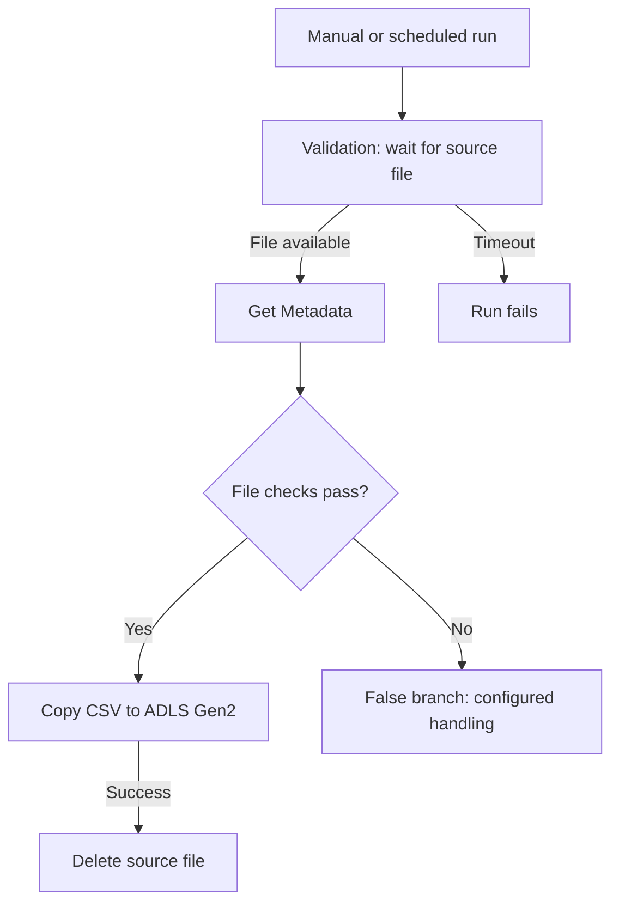
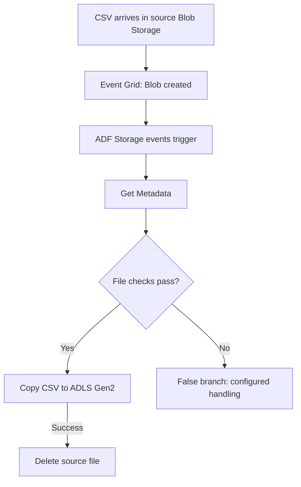
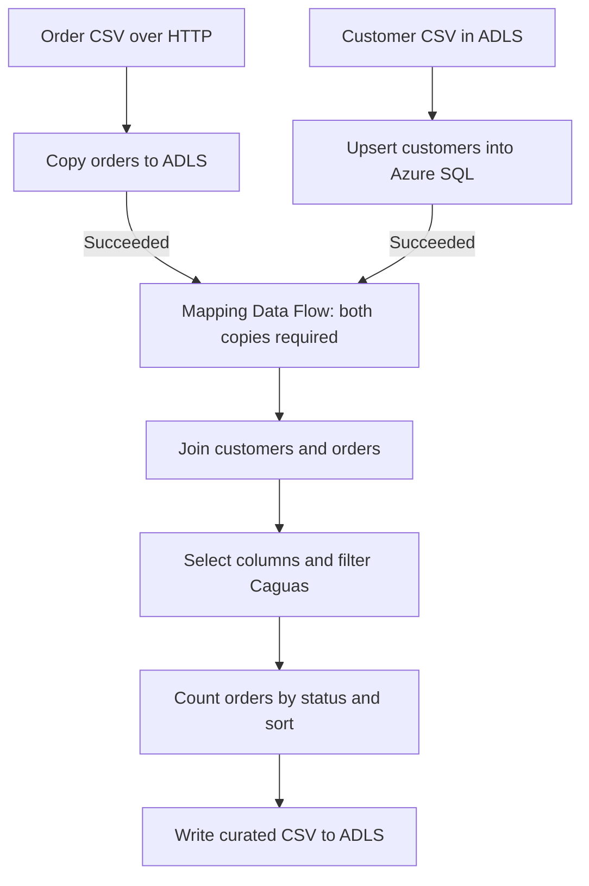
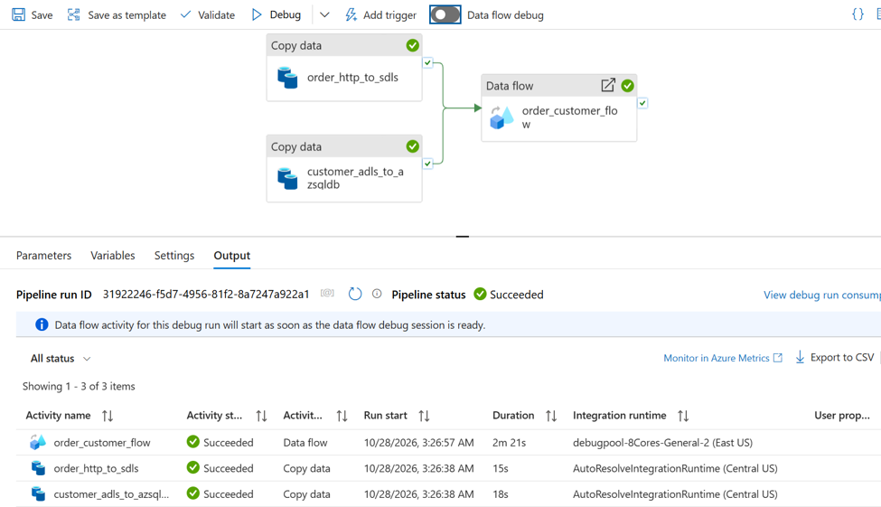
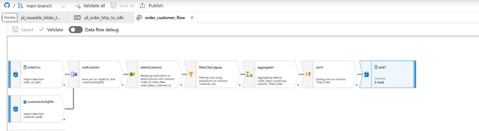
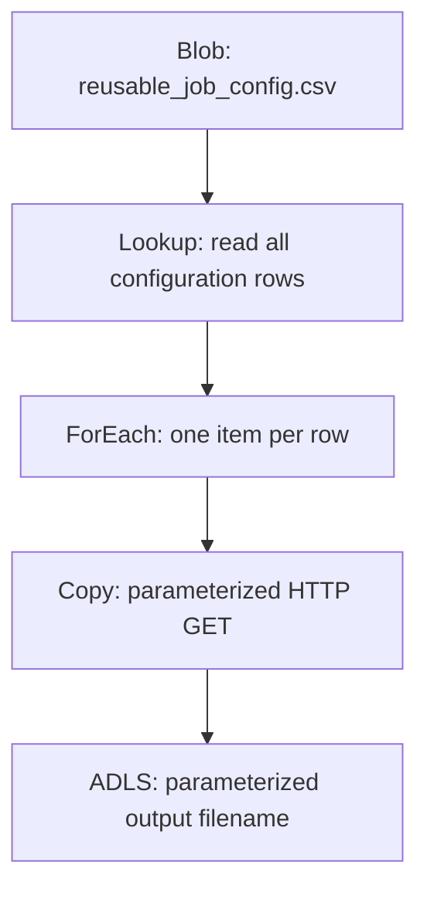
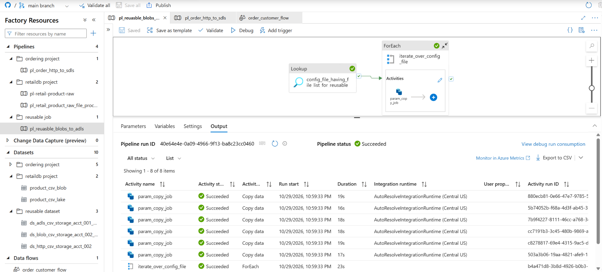

# Azure Data Factory: Ingestion, Transformation and Reusable Pipelines

A hands-on Azure Data Factory (ADF) project demonstrating four data engineering patterns: file polling, event-driven ingestion, multi-source transformation, and configuration-driven ingestion.

| Pipeline | Pattern | Implementation |
|---|---|---|
| [pl-retail-product-raw](pipeline/pl-retail-product-raw.json) | Polling | Validation → metadata checks → Copy → source cleanup |
| [pl_retail_product_raw_file_process_on_arrival](pipeline/pl_retail_product_raw_file_process_on_arrival.json) | Event-driven ingestion | Storage event → metadata checks → Copy → source cleanup |
| [pl_order_http_to_sdls](pipeline/pl_order_http_to_sdls.json) | Multi-source transformation | Parallel customer/order ingestion → join → filter → aggregate → ADLS |
| [pl_reuasble_blobs_to_adls](pipeline/pl_reuasble_blobs_to_adls.json) | Reusable ingestion | Lookup → ForEach → parameterized HTTP Copy for six files |

Existing resource names are retained so links match the ADF definitions, including the spelling of `pl_reuasble_blobs_to_adls`.

**Implemented:** file column-count checks, conditional processing, ingestion audit columns, source cleanup after successful copy, customer upserts, success dependencies, Mapping Data Flow transformations, and dataset/linked-service parameterization.

**Planned:** stronger data quality rules, controlled retries, run-level audit tables, partial-failure recovery, repeatable output publication, and automated deployment. This is a learning project demonstrating production-oriented patterns; the remaining work is listed below.

## Architecture

| Component | Purpose |
|---|---|
| Azure Blob Storage | Product landing files and the reusable ingestion configuration CSV |
| Azure Data Factory | Orchestrates validation, metadata checks, Copy, ForEach, and Mapping Data Flow |
| ADLS Gen2 | Customer input files, raw ingested files, and curated transformation output |
| HTTP connector | Retrieves order data and the reusable job's source files over HTTP/HTTPS |
| Azure SQL Database | Customer table loaded from ADLS using upsert on `customer_id` |
| Azure Event Grid | Delivers storage events to start the event-driven pipeline |
| Azure Monitor | Supports pipeline failure alerts and email action groups |
| GitHub | Versions ADF pipeline, dataset, linked service, and trigger definitions |

## Pipeline 1: Wait for a File with Validation

**Start:** Manual execution or a schedule trigger.




### How it works

1. Start the pipeline manually or through a schedule.
2. Validation checks the file referenced by the source dataset.
3. If validation does not succeed, it waits for the sleep interval before checking again.
4. Once the file meets the configured conditions, Get Metadata retrieves information used by the downstream checks.
5. The If Condition routes qualifying files to the Copy activity.
6. After a successful copy, the Delete activity removes the source file.

The current If Condition requires exactly six source columns. A mismatch runs the `file_format_issue` Fail activity with error code `420`. This is a structural check, not a full row-level data quality validation.

### Current validation settings

| Property | Example | Meaning |
|---|---|---|
| Dataset | Product CSV source dataset | Identifies the expected file |
| Timeout | `0.00:01:00` | Wait up to one minute |
| Sleep | `10` | Pause 10 seconds between validation attempts |
| Minimum size | Optional | Require a minimum file size when configured |

Validation checks immediately; it does not wait for the full timeout before the first check. If the file arrives during the waiting window, processing continues without waiting for the entire timeout.

If the timeout expires, Validation fails. With only a success dependency to subsequent activities and no successful failure handler, the pipeline run fails and Copy is skipped.

**Important:** Validation operates only within an active pipeline run. After the run ends, it stops checking. A later file arrival does not restart the pipeline.

**Use case:** A scheduled batch starts at a known time but its input file may arrive a few minutes late.

## Pipeline 2: Start on File Arrival

**Start:** A Storage events trigger listening for a matching Blob created event.




### How it works

1. A new matching file is uploaded to the source storage location.
2. Azure Storage emits an event through Event Grid.
3. The ADF trigger starts the associated published pipeline.
4. The pipeline retrieves metadata, evaluates its file checks, and copies the accepted file.
5. Source cleanup runs only after Copy succeeds.

The initial Validation activity is unnecessary for the basic single-file arrival flow because the event starts processing. Additional readiness validation may still be useful for multi-file dependencies or producer completion rules.

### Trigger configuration

| Setting | Configuration |
|---|---|
| Type | Storage events |
| Storage account | Source Blob Storage account |
| Container | Source landing container |
| Blob path begins with | Source folder filter, if required |
| Blob path ends with | Exact filename, such as `product.csv`, or suffix such as `.csv` |
| Event | Blob created |
| Status | Started after publishing |

For a dataset with a fixed filename, use a matching exact filename filter. A broad `.csv` filter requires parameterized processing to handle the particular file from each event.

### Extension: support varying filenames

Create pipeline parameters and populate them in the trigger-to-pipeline parameter mapping:

| Pipeline parameter | Trigger expression |
|---|---|
| `p_folder_path` | `@triggerBody().folderPath` |
| `p_file_name` | `@triggerBody().fileName` |

Pass these values into parameterized source datasets used by Get Metadata, Copy, and Delete. Match the dataset's container/folder split to the actual event folder path rather than duplicating the container name.

This ensures each run processes and deletes only its triggering file.

**Use case:** Product files arrive at unpredictable times and should be processed automatically.

## Pipeline 3: Customer and Order Transformation

**Definition:** [pl_order_http_to_sdls.json](pipeline/pl_order_http_to_sdls.json)  
**Mapping Data Flow:** [order_customer_flow.json](dataflow/order_customer_flow.json)

This pipeline brings together customer and order data from different sources, then produces order-status counts for customers in Caguas.



### Ingestion and dependencies

The two Copy activities have no dependencies on each other and can execute in parallel:

| Activity | Source | Destination / behavior |
|---|---|---|
| `order_http_to_sdls` | `order_csv_http` via HTTP GET | `order_csv_adls` in ADLS Gen2 |
| `customer_adls_to_azsqldb` | `customer_csv_adls` in ADLS Gen2 | `customer_sqldb` in Azure SQL; upsert key: `customer_id` |

The `order_customer_flow` activity has **Succeeded** dependencies on both copies. It starts only after both succeed. If either Copy fails, the transformation is skipped. A successful customer upsert is not automatically rolled back if the order Copy fails.

### Transformation logic

| Step | Current implementation |
|---|---|
| Sources | Orders from ADLS and customers from Azure SQL |
| Join | Inner join: `toInteger(order_customer_id) == customer_id` |
| Select | Retain selected order and customer fields; omit email and password from the selected output |
| Filter | Case-insensitive match on `customer_city = "Caguas"` |
| Aggregate | Group by `order_status`; calculate `Total_Order = count(order_id)` |
| Sort | Descending `Total_Order` |
| Sink | Delimited text with headers in `retail-raw/curated` in ADLS Gen2 |

The output columns are `order_status` and `Total_Order`. The count reflects joined rows with a non-null order ID, not a distinct-order count. Customer key uniqueness and order duplicate checks are therefore important future controls.

The Data Flow contains a sort transformation; consumers should not assume a global row order across multiple output files.

### Execution evidence

The supplied run screenshot shows both Copy activities and the Data Flow succeeded.





## Pipeline 4: Configuration-Driven Reusable Ingestion

**Definition:** [pl_reuasble_blobs_to_adls.json](pipeline/pl_reuasble_blobs_to_adls.json)

A single parameterized Copy activity is reused to ingest six source files via the HTTP connector into ADLS Gen2. Adding another compatible file requires a configuration row instead of another hardcoded Copy activity.

Despite the pipeline name containing "blobs", the Copy source is HTTP GET. Azure Blob Storage holds the lookup configuration file.



### Lookup and parameter flow

1. `config_file_having_file_list_for_reusable` reads `config/reusable_job_config.csv` in Blob Storage.
2. `firstRowOnly: false` returns all configuration rows as an array.
3. `iterate_over_config_file` uses:
   ```text
   @activity('config_file_having_file_list_for_reusable').output.value
   ```
4. For each row, `param_copy_job` passes source URL values and the destination filename into reusable datasets.
5. The source dataset forwards its base URL to the parameterized HTTP linked service.

| Configuration value referenced by Copy | Parameter destination | Used by |
|---|---|---|
| `@item().baseURL` | Source dataset `baseURL` → linked service `baseURL` | HTTP base URL |
| `@item().relativeURL` | Source dataset `relativeURL` | HTTP relative URL |
| `@item().fileName` | Sink dataset `fileName` | Destination filename |

The destination directory is currently fixed at `retail-raw/raw-reusable`. The file name is parameterized; container, folder, delimiter, and header handling are not dynamically selected per row.

**Configuration contract:** the committed Lookup dataset schema lists `BaseURL`, `RelativeURL`, and `fileName`, while the item expressions reference `baseURL`, `relativeURL`, and `fileName`. The actual configuration CSV is stored externally and is not committed. Align and verify the exact runtime Lookup field names and item expressions when reproducing the exercise. This documentation update does not change those definitions.

### Parallelism and scalability

The current ForEach definition does not explicitly set `isSequential` or `batchCount`. The supplied run screenshot shows all six Copy instances starting at the same displayed second, demonstrating parallel execution in that run.

For controlled scaling, configure a deliberate concurrency limit appropriate to source throttling, destination throughput, and cost. Enable sequential execution when ordering or shared-file dependencies require it.

This pattern reuses orchestration for compatible delimited files; it is not yet a universal ingestion framework for every connector and format.

### Reproducing the six-file run

1. Prepare six accessible HTTP/HTTPS file URLs.
2. Upload a six-row CSV configuration to the location referenced by the Lookup dataset.
3. Ensure Lookup returns the field names used by the Copy expressions.
4. Use unique destination filenames to avoid concurrent writes to the same path.
5. Configure source access and destination permissions; the current HTTP linked service uses anonymous authentication.
6. Run the pipeline and inspect Lookup output, ForEach iterations, and each Copy result.
7. Confirm all six expected destination files and reconcile row counts.

The configuration dataset expects a header row. The reusable source and sink data datasets currently use `firstRowAsHeader: false`; select input files accordingly. Copy parses and rewrites delimited data, so it is not a byte-for-byte binary transfer.

### Execution evidence

The supplied screenshot shows the Lookup, ForEach, and six instances of `param_copy_job` completing successfully. This is evidence of the demonstrated run, not a load test or validation of every future configuration.



## Comparing the Two Approaches

| Aspect | Validation pipeline | Storage-event pipeline |
|---|---|---|
| What starts the run? | Manual action or schedule | Matching file-arrival event |
| How is arrival detected? | Repeated checks during a run | Storage event delivered through Event Grid |
| Run active while file is absent? | Yes, until success or timeout | No run starts until an event is received |
| File never arrives | Validation eventually times out | No arrival-triggered run occurs |
| File arrives after timeout | Requires another run | A new matching event can start a run |
| Main dependency | Validation dataset and timing settings | Event Grid registration, permissions, and trigger filters |

An event trigger does not alert on a missing expected delivery by itself. Detecting a file that never arrived requires a separate scheduled completeness check.

## Audit Columns and File Metadata

The following fields can provide ingestion traceability:

| Field | Example value or expression |
|---|---|
| `_ingestion_dt` | `@pipeline().TriggerTime` |
| `_run_id` | `@pipeline().RunId` |
| `_file_nm` | `@activity('fetch_product_file_metadata').output.itemName` |
| `_file_size_bytes` | `@activity('fetch_product_file_metadata').output.size` |

Select **Item name** and **Size** in the Get Metadata activity's field list before referencing these outputs. Adapt the activity name to match the pipeline.

- **Source → Additional columns:** adds values to each data row; include them in explicit Mapping when used.
- **Sink → Metadata:** attaches key/value properties to the stored file; these do not appear inside the CSV.

The trigger timestamp records the pipeline's trigger time. Use `@utcNow()` instead if the intended meaning is the time the expression is evaluated during ingestion.

## Setup

1. Provision ADF, source/configuration Blob Storage, destination ADLS Gen2, and Azure SQL Database for Pipeline 3.
2. Configure linked services and grant the required source-read, destination-write, and source-delete access.
3. Create the source/destination DelimitedText and Azure SQL datasets, including the correct header and delimiter settings. Provide the external sample data and reusable-job configuration; these data files are not included in the repository.
4. Configure the activities and If Condition expression.
5. Set validation timeout and sleep for Pipeline 1.
6. Register `Microsoft.EventGrid` on the subscription and configure the storage trigger for Pipeline 2. The user configuring the trigger also needs permission to create the event subscription on the source storage account.
7. Connect ADF to GitHub and save the definitions.
8. Publish changes before testing triggered executions. Saving to GitHub and publishing to the live factory are separate actions.

Keep account-specific resource names configurable and credentials out of the repository.

## Test Scenarios

The following are reproducible checks; not every failure scenario has been demonstrated. Successful runs for Pipelines 3 and 4 are shown in their screenshots.

Test the pipelines separately so they do not compete to copy or delete the same source file.

| Scenario | Action | Expected result |
|---|---|---|
| File already exists | Start Pipeline 1 | Validation succeeds and eligible data is copied |
| Delayed file | Start Pipeline 1, then upload within its timeout | A subsequent validation attempt detects the file |
| Missing file | Run Pipeline 1 without uploading | Validation times out and the success path is skipped |
| Arrival event | Publish/start Pipeline 2's trigger, then upload a matching file | A pipeline run starts automatically |
| Nonmatching path | Upload outside the configured filters | No run starts from that trigger |
| Audit fields | Inspect the newly generated destination CSV | Row columns appear only if configured as Additional columns and mapped |
| Cleanup | Inspect the source after successful processing | The processed source file is deleted |

Files already present when the event trigger is enabled are not automatically backfilled. Upload a new matching file to test event delivery.

Check **Monitor → Pipeline runs** and **Trigger runs**, and inspect activity input/output for troubleshooting. Allow for event delivery and pipeline startup latency.

## Failure Notifications

To configure a standard failure email:

1. Register `Microsoft.Insights` on the subscription.
2. Open **Monitor → Alerts & metrics**.
3. Create an alert on **Failed pipeline runs**, using **Total > 0**.
4. Scope the pipeline dimension as required.
5. Attach an email action group and enable the rule.
6. Test with a published, triggered run that intentionally fails.

This is a monitoring configuration separate from the pipeline flow. Verify the actual alert rule and action group in Azure; their existence is not established by pipeline JSON alone.

## Production Improvements

### Planned production handling for Pipeline 3

Customer upsert on `customer_id` and the two success dependencies are already implemented. The following items are **planned**, not completed:

| Priority | Improvement | Planned behavior / acceptance check |
|---|---|---|
| 1 | Safe customer reruns | Validate non-null, unique customer keys; rerun the same input and confirm stable customer counts and values |
| 1 | Partial-failure recovery | Force order Copy to fail after customer success; confirm transformation is skipped, then recover without duplicating customers |
| 1 | Repeatable ADLS output | Define a business-date/batch output path and replacement/publication policy so reruns do not expose duplicate or stale aggregate files |
| 1 | Controlled retries | Add bounded retries for transient HTTP/SQL failures; the current Copy and Data Flow policies have `retry: 0` |
| 2 | Data quality and rejects | Validate key casts, required fields and dates; detect duplicate orders and route invalid rows to quarantine with a reason |
| 2 | Join reconciliation | Record unmatched order/customer counts before the inner join so dropped records are visible |
| 2 | Run audit table | Capture run ID, batch ID, per-activity status, input/output/reject counts, timestamps and error details |
| 2 | Failure alert verification | Configure and test pipeline failure emails, including a failure in either parallel branch |
| 3 | Consistent customer snapshot | Replace `READ_UNCOMMITTED` with an isolation/staging approach appropriate to concurrent writes and batch consistency |
| 3 | Schema and output contracts | Review schema drift, allowed truncation, field types and expected aggregate schema; fail or quarantine incompatible inputs |
| 3 | Deployment and cost controls | Parameterize environments, automate validation/deployment, and tune compute based on measured workload |

**Recovery demonstration to add:** customer upsert succeeds → order Copy fails → Data Flow is skipped → source issue is fixed → rerun succeeds → customer counts remain stable and only the intended curated batch is published.

### Planned extensions for Pipeline 4

- Commit a sanitized six-row configuration example with consistent header casing and reachable sample-data instructions.
- Validate missing URLs, duplicate destination names and unsupported file settings before copying.
- Set explicit ForEach concurrency and add per-file audit/retry status.
- Support rerunning failed configuration items without reprocessing successful ones.
- Parameterize destination folders and format settings where needed.

### Further improvements for the file-arrival pipelines

Before extending the product-file flows to production:

- Make processing idempotent: storage event delivery can be duplicated, so avoid assuming one event means exactly one processing attempt.
- Use unique file names or delivery identifiers to avoid concurrent overwrites of the same source path.
- Establish a producer completion convention for files that are uploaded in stages; file existence or minimum size alone is not a universal completeness guarantee.
- Consider archiving inputs instead of immediate deletion to support replay and reconciliation.
- Add a delivery audit/control table, rejected-file handling, and row-count reconciliation.
- Define retries and recovery for the case where Copy succeeds but source deletion fails.
- Use managed identities and appropriately scoped permissions.

## Suggested Repository Layout

ADF generates its resource folders under the configured Git root. For a dedicated ADF repository using `/`, a typical layout is:

```text
.
├── README.md
├── pipeline/
├── dataflow/             # Mapping Data Flow definitions
├── dataset/
├── linkedService/
├── trigger/
└── docs/images/          # Pipeline and successful-run screenshots
```

The README retains the product-pipeline screenshots and includes the transformation and reusable-ingestion screenshots above. Future failure/recovery tests should add their own execution evidence.

## Cost Management During Practice

Turn off Data Flow debug after testing, cancel unwanted active runs, and stop triggers that should not run unattended. Check Databricks compute separately if used in other exercises. SQL serverless auto-pause depends on its configuration and database inactivity; storage and monitoring may still incur charges.

## References

- [ADF Validation activity](https://learn.microsoft.com/en-us/azure/data-factory/control-flow-validation-activity)
- [Create storage event triggers](https://learn.microsoft.com/en-us/azure/data-factory/how-to-create-event-trigger)
- [Add additional columns during copy](https://learn.microsoft.com/en-us/azure/data-factory/copy-activity-overview#add-additional-columns-during-copy)
- [ADLS Gen2 connector](https://learn.microsoft.com/en-us/azure/data-factory/connector-azure-data-lake-storage)
- [ADF source control](https://learn.microsoft.com/en-us/azure/data-factory/source-control)
