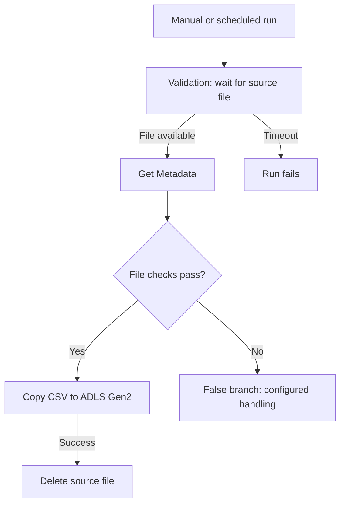
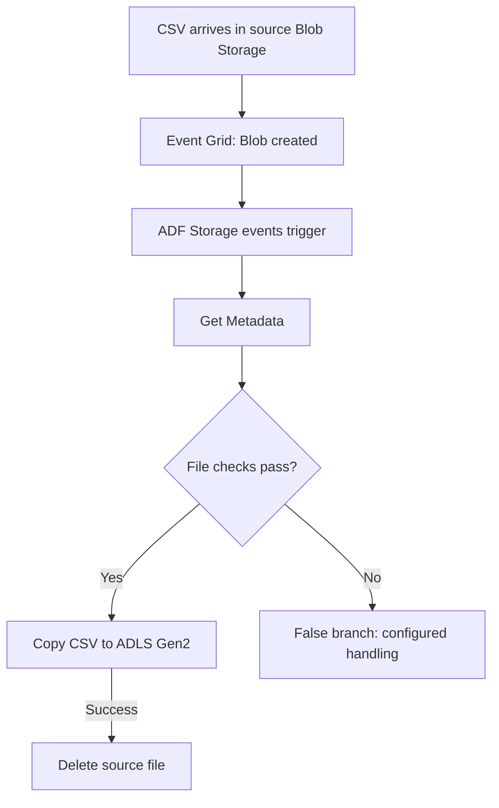

# Azure Data Factory: File Ingestion with Polling and Storage Events

This learning project demonstrates two ways to ingest a product CSV file from Azure Blob Storage into Azure Data Lake Storage Gen2 using Azure Data Factory (ADF):

1. A pipeline that waits for an expected file using a **Validation activity**.
2. A pipeline that starts automatically when a file arrives using a **Storage events trigger**.

The project explores file readiness checks, conditional processing, audit information, source cleanup, monitoring, and GitHub integration.

## Architecture

| Component | Purpose |
|---|---|
| Azure Blob Storage | Source landing location for product CSV files |
| Azure Data Factory | Orchestrates validation, metadata checks, copy, and cleanup |
| ADLS Gen2 | Destination for ingested files |
| Azure Event Grid | Delivers storage events to start the event-driven pipeline |
| Azure Monitor | Supports pipeline failure alerts and email action groups |
| GitHub | Versions ADF pipeline, dataset, linked service, and trigger definitions |

## Pipeline 1: Wait for a File with Validation

**Start:** Manual execution or a schedule trigger.



### How it works

1. Start the pipeline manually or through a schedule.
2. Validation checks the file referenced by the source dataset.
3. If validation does not succeed, it waits for the sleep interval before checking again.
4. Once the file meets the configured conditions, Get Metadata retrieves information used by the downstream checks.
5. The If Condition routes qualifying files to the Copy activity.
6. After a successful copy, the Delete activity removes the source file.

The precise acceptance rule is defined by the If Condition expression in the pipeline JSON. Inspect that expression when reviewing or adapting the project.

### Example validation settings

| Property | Example | Meaning |
|---|---|---|
| Dataset | Product CSV source dataset | Identifies the expected file |
| Timeout | `0.00:05:00` | Wait up to five minutes |
| Sleep | `60` | Pause 60 seconds between validation attempts |
| Minimum size | Optional | Require a minimum file size when configured |

Validation checks immediately; it does not wait five minutes before the first check. If the file arrives during the waiting window, processing continues without waiting for the entire timeout.

If the timeout expires, Validation fails. With only a success dependency to subsequent activities and no successful failure handler, the pipeline run fails and Copy is skipped.

**Important:** Validation operates only within an active pipeline run. After the run ends, it stops checking. A later file arrival does not restart the pipeline.

**Use case:** A scheduled batch starts at a known time but its input file may arrive a few minutes late.

## Pipeline 2: Start on File Arrival

**Start:** A Storage events trigger listening for a matching Blob created event.



```
image.png
```


### How it works

1. A new matching file is uploaded to the source storage location.
2. Azure Storage emits an event through Event Grid.
3. The ADF trigger starts the associated published pipeline.
4. The pipeline retrieves metadata, evaluates its file checks, and copies the accepted file.
5. Source cleanup runs only after Copy succeeds.

The initial Validation activity is unnecessary for the basic single-file arrival flow because the event starts processing. Additional readiness validation may still be useful for multi-file dependencies or producer completion rules.

### Trigger configuration

| Setting | Configuration |
|---|---|
| Type | Storage events |
| Storage account | Source Blob Storage account |
| Container | Source landing container |
| Blob path begins with | Source folder filter, if required |
| Blob path ends with | Exact filename, such as `product.csv`, or suffix such as `.csv` |
| Event | Blob created |
| Status | Started after publishing |

For a dataset with a fixed filename, use a matching exact filename filter. A broad `.csv` filter requires parameterized processing to handle the particular file from each event.

### Extension: support varying filenames

Create pipeline parameters and populate them in the trigger-to-pipeline parameter mapping:

| Pipeline parameter | Trigger expression |
|---|---|
| `p_folder_path` | `@triggerBody().folderPath` |
| `p_file_name` | `@triggerBody().fileName` |

Pass these values into parameterized source datasets used by Get Metadata, Copy, and Delete. Match the dataset's container/folder split to the actual event folder path rather than duplicating the container name.

This ensures each run processes and deletes only its triggering file.

**Use case:** Product files arrive at unpredictable times and should be processed automatically.

## Comparing the Two Approaches

| Aspect | Validation pipeline | Storage-event pipeline |
|---|---|---|
| What starts the run? | Manual action or schedule | Matching file-arrival event |
| How is arrival detected? | Repeated checks during a run | Storage event delivered through Event Grid |
| Run active while file is absent? | Yes, until success or timeout | No run starts until an event is received |
| File never arrives | Validation eventually times out | No arrival-triggered run occurs |
| File arrives after timeout | Requires another run | A new matching event can start a run |
| Main dependency | Validation dataset and timing settings | Event Grid registration, permissions, and trigger filters |

An event trigger does not alert on a missing expected delivery by itself. Detecting a file that never arrived requires a separate scheduled completeness check.

## Audit Columns and File Metadata

The following fields can provide ingestion traceability:

| Field | Example value or expression |
|---|---|
| `_ingestion_date` | `@pipeline().TriggerTime` |
| `_run_id` | `@pipeline().RunId` |
| `_file_name` | `@activity('fetch_product_file_metadata').output.itemName` |
| `_file_size_bytes` | `@activity('fetch_product_file_metadata').output.size` |

Select **Item name** and **Size** in the Get Metadata activity's field list before referencing these outputs. Adapt the activity name to match the pipeline.

- **Source → Additional columns:** adds values to each data row; include them in explicit Mapping when used.
- **Sink → Metadata:** attaches key/value properties to the stored file; these do not appear inside the CSV.

The trigger timestamp records the pipeline's trigger time. Use `@utcNow()` instead if the intended meaning is the time the expression is evaluated during ingestion.

## Setup

1. Provision ADF, source Blob Storage, and destination ADLS Gen2.
2. Configure linked services and grant the required source-read, destination-write, and source-delete access.
3. Create the source and destination DelimitedText datasets, including the correct header and delimiter settings.
4. Configure the activities and If Condition expression.
5. Set validation timeout and sleep for Pipeline 1.
6. Register `Microsoft.EventGrid` on the subscription and configure the storage trigger for Pipeline 2. The user configuring the trigger also needs permission to create the event subscription on the source storage account.
7. Connect ADF to GitHub and save the definitions.
8. Publish changes before testing triggered executions. Saving to GitHub and publishing to the live factory are separate actions.

Keep account-specific resource names configurable and credentials out of the repository.

## Test Scenarios

Test the pipelines separately so they do not compete to copy or delete the same source file.

| Scenario | Action | Expected result |
|---|---|---|
| File already exists | Start Pipeline 1 | Validation succeeds and eligible data is copied |
| Delayed file | Start Pipeline 1, then upload within its timeout | A subsequent validation attempt detects the file |
| Missing file | Run Pipeline 1 without uploading | Validation times out and the success path is skipped |
| Arrival event | Publish/start Pipeline 2's trigger, then upload a matching file | A pipeline run starts automatically |
| Nonmatching path | Upload outside the configured filters | No run starts from that trigger |
| Audit fields | Inspect the newly generated destination CSV | Row columns appear only if configured as Additional columns and mapped |
| Cleanup | Inspect the source after successful processing | The processed source file is deleted |

Files already present when the event trigger is enabled are not automatically backfilled. Upload a new matching file to test event delivery.

Check **Monitor → Pipeline runs** and **Trigger runs**, and inspect activity input/output for troubleshooting. Allow for event delivery and pipeline startup latency.

## Failure Notifications

To configure a standard failure email:

1. Register `Microsoft.Insights` on the subscription.
2. Open **Monitor → Alerts & metrics**.
3. Create an alert on **Failed pipeline runs**, using **Total > 0**.
4. Scope the pipeline dimension as required.
5. Attach an email action group and enable the rule.
6. Test with a published, triggered run that intentionally fails.

This is a monitoring configuration separate from the pipeline flow. Verify the actual alert rule and action group in Azure; their existence is not established by pipeline JSON alone.

## Production Improvements

This repository demonstrates learning patterns. Before extending them to production:

- Make processing idempotent: storage event delivery can be duplicated, so avoid assuming one event means exactly one processing attempt.
- Use unique file names or delivery identifiers to avoid concurrent overwrites of the same source path.
- Establish a producer completion convention for files that are uploaded in stages; file existence or minimum size alone is not a universal completeness guarantee.
- Consider archiving inputs instead of immediate deletion to support replay and reconciliation.
- Add a delivery audit/control table, rejected-file handling, and row-count reconciliation.
- Define retries and recovery for the case where Copy succeeds but source deletion fails.
- Use managed identities and appropriately scoped permissions.

## Suggested Repository Layout

ADF generates its resource folders under the configured Git root. For a dedicated ADF repository using `/`, a typical layout is:

```text
.
├── README.md
├── pipeline/
├── dataset/
├── linkedService/
├── trigger/
└── docs/                 # Optional architecture and execution screenshots
```

Add sanitized screenshots of both pipeline canvases, trigger filters, successful runs, and a validation timeout to make the implementation easier to review.

## References

- [ADF Validation activity](https://learn.microsoft.com/en-us/azure/data-factory/control-flow-validation-activity)
- [Create storage event triggers](https://learn.microsoft.com/en-us/azure/data-factory/how-to-create-event-trigger)
- [Add additional columns during copy](https://learn.microsoft.com/en-us/azure/data-factory/copy-activity-overview#add-additional-columns-during-copy)
- [ADLS Gen2 connector](https://learn.microsoft.com/en-us/azure/data-factory/connector-azure-data-lake-storage)
- [ADF source control](https://learn.microsoft.com/en-us/azure/data-factory/source-control)
